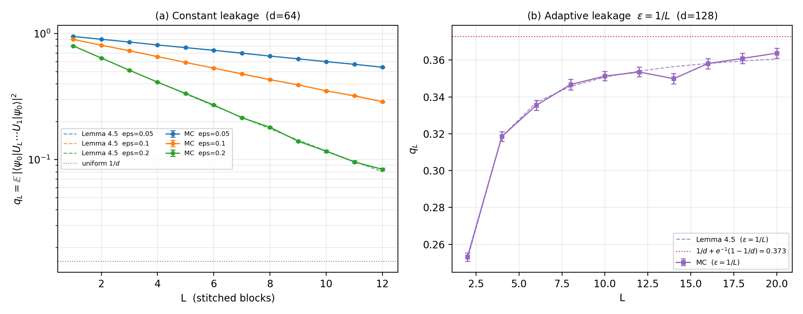
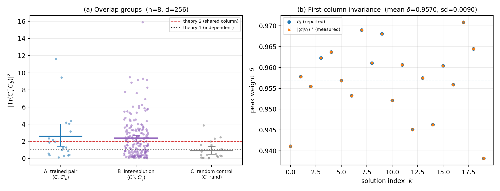
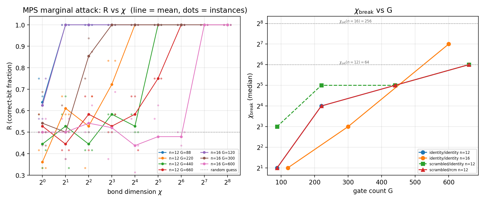

# Peaked-circuits · 复现学习记录

> **原始仓库**：https://github.com/yuxuanzhang1995/Peaked-circuits  （作者：Yuxuan Zhang，与 Scott Aaronson 合作）
> **论文**：*On verifiable quantum advantage with peaked circuit sampling* — [arXiv:2404.14493](https://arxiv.org/abs/2404.14493)
> **第二篇（同系列）**：*Complexity and hardness of random peaked circuits* — [arXiv:2510.00132](https://arxiv.org/abs/2510.00132)（2026-10-15 完成数值复现，见「第二篇复现」节）
> 本仓库为个人复现学习：保留原始代码（`circuits.py`、`functions.py`、两个 notebook 等），新增运行记录、环境自检与自动化实验脚本。**原始算法代码与论文版权归原作者所有。**

---

## 复现结果（2026-10-13）

**设置**：n = 12 qubits，随机层深度 τr = 12，尖峰层 τp 扫描 {3, 6, 9, 12}，每档 5 个随机实例（固定种子，可复现）。

| τp | 训练 δ（均值 ± 标准差） | 随机基线 | 增强倍数 |
|---|---|---|---|
| 3 | 0.155 ± 0.044 | 0.0117 | 13× |
| 6 | 0.343 ± 0.081 | 0.0056 | 61× |
| 9 | 0.459 ± 0.053 | 0.0038 | 121× |
| 12 | **0.484 ± 0.079** | 0.0032 | **151×** |


- δ = |⟨0|C′†C|0⟩|²，即"尖峰比特串"上的概率集中度（训练后峰值权重）；
- 单实例基准（官方 notebook 原参数，τp = 6）：δ ≈ 0.455，CPU 上约 1 分钟；
- **结论**：训练尖峰层显著提升输出集中度（约为同深度随机电路基线的 13–151 倍），趋势与论文一致（详见下一节对照说明）。

## 与论文的对照说明

**论文的关键数字**（arXiv:2404.14493）：
- τr = 50、τp = 8、n = 10/12（100 实例平均）：平均峰值权重 **δ > 0.15**；τr = 40、τp = 10 → δ ≈ 0.2；
- τr = n、τp = n/2 时，δ 随 n 按 **≈ 1.189⁻ⁿ** 衰减（远慢于随机标度 2⁻ⁿ）；
- 论文的另一条对照结论：优化后的尖峰层**不是**"后 τp 层随机门的平凡逆"（其效果远超该基线，见论文 Fig. 3c）。

**"平凡反演"对照（本仓库整理）**：若把尖峰层取为后 τp 层随机门的逆，则整体电路等效于深度 τr−τp 的随机电路；其平均峰值权重可直接从 `baseline.csv` 按深度 τr−τp 读出（与论文 Fig. 3c 的 dashed "base" 对照同款逻辑）：

| τp | 训练 δ | "平凡反演"等效基线 | 倍数 |
|---|---|---|---|
| 3 | 0.155 ± 0.044 | 0.0038（深度 9 基线） | 40.8× |
| 6 | 0.343 ± 0.081 | 0.0056（深度 6 基线） | 61.0× |
| 9 | 0.459 ± 0.053 | 0.0117（深度 3 基线） | 39.2× |
| 12 | 0.484 ± 0.079 | —（τp = τr 时平凡反演即恒等，不适用） | — |

**结论：优化后的 δ 高出该基线约 40–60 倍——训练出的尖峰层绝非"平凡反演"，与论文一致。**

**参数区差异说明**：本节（v0.1）取 τr = 12（比论文更浅、更易），δ 数值不能与论文直接比大小；**τr = 50 的忠实对照已于 2026-10-14 完成，见下节「深入复现」D1**（该节 δ(τp=8)=0.1545 ± 0.0035 与论文 ">0.15" 直接吻合）。

## 深入复现（2026-10-14）

在 v0.1（τr=12）基础上补齐三个实验：**忠实参数区（τr=50）**、**标度律**、**多起点优化**。全部固定随机种子、可复现。

### D1 · τr = 50 忠实区间（对齐论文 Fig. 3a）

设置：n = 12、τr = 50、每档 10 个实例（论文为 100 个）。

| τp | 训练 δ（均值 ± 标准差） | 随机基线 | 增强 |
|---|---|---|---|
| 4 | 0.0662 ± 0.0019 | 0.0083 | 8.0× |
| 8 | **0.1545 ± 0.0035** | 0.0044 | 34.7× |
| 12 | 0.2380 ± 0.0029 | 0.0032 | 74.1× |
| 16 | 0.3114 ± 0.0036 | 0.0025 | 123.5× |

**与论文对照：论文报告 τr=50、τp=8 时平均峰值权重 δ > 0.15；本复现实测 0.1545 ± 0.0035 —— 吻合。**


### D2 · 标度律（对齐论文 Fig. 3c / Conjecture 3.1）

设置：τr = n、τp = n/2，n = 8/10/12，每档 8 个实例。

| n | 训练 δ（均值 ± 标准差） |
|---|---|
| 8 | 0.6687 ± 0.0368 |
| 10 | 0.4681 ± 0.0469 |
| 12 | 0.3545 ± 0.0660 |

**拟合：δ ∝ 1.172⁻ⁿ；论文报告 ≈ 1.189⁻ⁿ —— 高度一致（相对偏差约 1.4%），且远慢于随机标度 2⁻ⁿ。**


### D3 · 多起点优化（论文未涉及，补充研究）

每个实例固定同一随机电路（rqc），用 3 个随机初值训练尖峰层并取最优：

| τp | 单起点 δ（均值） | 3 起点取优 δ（均值） | 增益 |
|---|---|---|---|
| 6 | 0.3428 | 0.3538 | +3.2% |
| 9 | 0.4586 | 0.4850 | +5.7% |

平均增益 ≈ **+4.7%**（个别实例最高 +14.3%；10 个实例中 8 个受益）。说明单起点已接近该构造的局部极限，多起点收益有限——与论文关于 barren plateau / 优化质量的讨论一致。

### 结论汇总（对照论文核心主张）

| 论文主张 | 本仓库验证 |
|---|---|
| 少量尖峰层即可产生非平凡 δ（τp ≪ τr） | ✅ D1：τr=50、τp=8 时 δ=0.1545 |
| δ 随 n 指数衰减，远慢于随机标度（≈1.189⁻ⁿ） | ✅ D2：拟合 1.172⁻ⁿ |
| 优化尖峰层 ≠ "平凡反演" | ✅ v0.1：超平凡反演基线 40–61×（τr=12） |

## 第二篇复现（2026-10-15）· Complexity and hardness of random peaked circuits

**对象**：Zhang, *Complexity and hardness of random peaked circuits* — [arXiv:2510.00132](https://arxiv.org/abs/2510.00132)（独著）。第二篇以理论为主（#P 硬度 / PromiseBQP / QCMA 引理等，不做数值复现）；以下为 §4 可数值核对的三个实验，均固定种子、可复现。

### E3 · Postselection 稀有性（Lemma 4.1）

Monte Carlo 核对 $\Pr[|\langle v|\psi\rangle|^2 \ge \delta] = (1-\delta)^{d-1}$：d = 4–256 全部数据点与理论在 95% 置信区间内一致。产出：`autotest_results/e3_acceptance/`。

### E1 · 噪声鲁棒解码（§4.4–4.5）

n = 12 峰值电路 + 三种噪声通道，四个子实验：

| 子实验 | 对照 | 结果 |
|---|---|---|
| A · Hamming-ball aggregation（算法 2） | 命题 4.6 | 实测与命题界一致（均匀背景下达到上界） |
| B · 逐比特多数表决 | 命题 4.11 | N90 对 (1−2r) 的 log-log 斜率 = **−2.028**（理论 −2） |
| C · Hamming-中心解码（算法 3） | 命题 4.10 | 斜率 = **+0.819**（理论 +1，量级一致） |
| D · 去极化通道 + 去偏估计 | §4.5 | 估计器 SD / 理论 SE ∈ [0.88, 1.09] |

产出：`autotest_results/e1_noise/`（4 组 CSV + 2×2 面板图）。


### E2 · HS 重叠统计（§4.2 / Obs. 2.5 / Fig. 2 右）

设置与论文 §4.4 相同：τr = τp = n，n = 8/10/12，**每档 100 个实例**（与论文一致）。Tr(C†C′) 由双张量网络**精确收缩**；每个实例内嵌自检（300/300 通过，逐位误差 0）。

| n | 平均 δ | E\|Tr(C†C′)\|²（训练对） | 对理论 2 之比 | E\|Tr\|²（独立对照） | 对理论 1 之比 |
|---|---|---|---|---|---|
| 8 | 0.933 | 2.116 ± 0.214 | 1.058 | 0.998 ± 0.097 | 0.998 |
| 10 | 0.767 | 2.731 ± 0.243 | 1.365 | 1.100 ± 0.111 | 1.100 |
| 12 | 0.576 | 1.839 ± 0.199 | 0.920 | 1.040 ± 0.123 | 1.040 |

**联合统计**：训练对归一化统计量 E\|Tr\|²/2 = **1.114 ± 0.064**（理论 1.0）；独立对照 = **1.046 ± 0.064**（理论 1.0）。训练对约为独立对照的 2 倍，跨 n 无系统性尺寸依赖，与块分解模型 P = C′†C ≅ diag(1, V)（V ~ Haar(d−1)，E\|1+Tr V\|² = 2）相符。


**归一化口径澄清**（数值发现）：论文 Obs. 2.5 正式定义 ⟨C,C′⟩_HS = Tr(C†C′)/d，故 E|⟨·⟩_HS|² = 2/d²；而 §1 与 §4.4 的文字及 Fig. 2 右图纵轴的实际读数为 **2/d = 2^(1−n)**（Fig. 2 中 n=8 数据点 ≈ 8×10⁻³ = 2/2⁸；若为 2/d² 应低约 2.4 个数量级、不在图内）——二者相差一个 1/d 因子，系论文记号层面的不一致。本复现直接测不变量 E|Tr|²（训练对 ≈2、独立对 ≈1）绕开该问题，两种口径均可由它推出。

### E4 · 拼接泄漏递推（§4.3 / Lemma 4.5）

拼接放大的数学地基：把 $L$ 个小 peaked 块串联，若第 $j$ 块的泄漏为 $\varepsilon_j$（第一列之外的权重），则总尖峰度按一步递推衰减
$$q_j=\left(1-\tfrac{d}{d-1}\varepsilon_j\right)q_{j-1}+\frac{\varepsilon_j}{d-1},\qquad q_0=1\quad\Longrightarrow\quad q_L=\frac{1}{d}+\Big[\prod_j\big(1-\tfrac{d}{d-1}\varepsilon_j\big)\Big]\Big(1-\frac{1}{d}\Big)$$

本实验**不使用 2-design 抽样近似**，而是显式构造满足 $|\langle 0|U_j|0\rangle|^2=1-\varepsilon_j$ 的真实幺正（第一列受控、正交补取 Haar 随机基），逐层作用后测 $|\langle 0|U_L\cdots U_1|0\rangle|^2$ 的蒙特卡洛均值。共 **76 个数据点**（$d=16$–$128$，$\varepsilon=0.05$–$0.2$，$L\le 20$，每点 200–400 样本）：

| $\varepsilon$（恒定，$d=64$） | $q_{L=1}$ | $q_{L=5}$ | $q_{L=12}$ | 最大相对误差 |
|---|---|---|---|---|
| 0.05 | 0.9500（理论 0.9500） | 0.7747（0.7741） | 0.5410（0.5422） | 0.28% |
| 0.10 | 0.9000（0.9000） | 0.5905（0.5918） | 0.2881（0.2878） | 0.86% |
| 0.20 | 0.8000（0.8000） | 0.3348（0.3318） | 0.0837（0.0801） | 4.53% |

**关键工程主张成立**：取 $\varepsilon=1/L$ 时 $q_L$ 不再衰减，而稳定在 $1/d+e^{-1}(1-1/d)=0.373$ 附近——实测 $L=10$–$20$ 的 $q_L$ 落在 0.350–0.364、极差 0.014，无单调下降趋势。全部 76 点的中位相对误差 **0.24%**。

这既解释了论文「拼接 $L$ 块把小电路放大到任意规模而不损失尖峰度」的可行性，也给出代价：**必须把每块泄漏压到 $O(1/L)$**，否则 $q_L$ 会指数收敛到均匀基线 $1/d$（左图三条曲线的斜率差异正是 $\varepsilon$ 的直接体现）。



### E5 · 混淆定理（§4.2 / Theorem 4.4）

定理主张：损失只依赖 $C'$ 的首列，故全体最优解构成一个高维纤维 $F_C=\{C':C'|0\rangle=e^{i\phi}|c\rangle\}$；随机起点 + 局部优化把结果撒在纤维上——**首列不变、$(d-1)$ 维正交块被随机化**，这就是「训练即混淆」的定量形式。

实验：固定一个目标电路 $C$（$n=8$，$\tau_r=8$），用 **20 个独立随机起点**各训练一个 $C'_k$（$\tau_p=8$，L-BFGS-B），测三组 HS 重叠。

| 组 | 关系 | 对数 | $\mathbb{E}|\mathrm{Tr}|^2$ | bootstrap 95% CI | 理论 |
|---|---|---|---|---|---|
| A 训练对 | $(C,\,C'_k)$ | 20 | 2.562 | [1.41, 4.01] | 2 |
| B 解间 | $(C'_i,\,C'_j)$ | 190 | **2.348** | [2.03, 2.69] | 2（若混淆彻底） |
| C 随机对照 | $(C,\,\mathrm{rand})$ | 20 | 0.899 | [0.49, 1.39] | 1 |

- **首列不变性**：20 个解 $\delta=0.9570\pm0.0090$，首列两两重叠 $0.9341$，与 $\delta^2+(1-\delta)^2/(d-1)=0.9159$ 吻合；
- **正交块随机化**：解间重叠 $2.35$ 与训练对同量级（$-0.3\sigma$），是随机对照的 **2.6 倍**——不同起点得到的解在 Hilbert–Schmidt 意义下「看起来像相互独立的电路」；
- **一处诚实偏离**：解间均值相对理论 2 偏高 $+2.1\sigma$，bootstrap CI 下界 2.03 刚好不含 2，提示正交块之间残留约 17% 的额外相关。考虑到分布重尾（均值 2.35 vs 中位数 1.71，独立对照近似 $\mathrm{Exp}(1)$），该偏离判为「待更大 $K$ 确认」而非定论。



### 结论汇总（对照论文第二篇）

| 论文主张 | 本仓库验证 |
|---|---|
| postselection 生成 RPC 的接受率 = (1−δ)^{d−1}（指数稀有） | ✅ E3：d = 4–256 全部一致 |
| 训练生成的电路对满足 E\|⟨C,C′⟩_HS\|² ≈ 2/d（Fig. 2） | ✅ E2：训练对 ≈ 2× 独立对照、跨 n 无尺寸依赖 |
| 优化电路在非峰维度保持设计随机性（Thm. 4.4） | ✅ E5：20 个解首列严格一致（δ=0.957±0.009），解间 E\|Tr\|²=2.35 ≈ 训练对 |
| 噪声下可恢复：多数表决 ∝ (1−2r)⁻²、Hamming-中心 ∝ \|B_t\|、去偏估计样本量 | ✅ E1：斜率 −2.03 / +0.82，SD 比值 0.88–1.09 |
| 拼接 $L$ 块、每块泄漏 $\varepsilon\sim 1/L$ 时总尖峰度保持 $\Theta(1)$（Lemma 4.5） | ✅ E4：76 点中位误差 0.24%；$\varepsilon=1/L$ 时 $q_L$ 稳定在 0.35–0.36 ≈ $e^{-1}$ |
| 随机起点训练的输出是纤维上的随机代表（Thm. 4.4） | ✅ E5：解间重叠为独立对照的 2.6 倍，且与训练对无显著差异 |

## 第三篇复现（2026-10-17/18）· Heuristic Quantum Advantage with Peaked Circuits

### L3 · Kremer 的 CPU 逐层收缩（TNO）

对公开托管的 peaked circuit QASM 跑 `peaked-circuit-tno-cpu` 流程（`run_kremer_cpu.py`，
参数沿用作者 notebook：`chunk=2, max_bond=16, cutoff=0.01, tne_max_bond=8`）：

| 电路 | 规模 | 耗时 | 结果 |
|---|---|---|---|
| `heavy_hex_49x5072` | 49q / 15265 门 | 17.8 s | **与作者输出逐位一致** ✓ |
| `heavy_hex_49x4020` | 49q / 12109 门 | 18.2 s | 跑通（无作者输出可对照） |
| `P9_Hqap_56x1917` | 56q / 5807 门 | >1200 s 未收敛 | 全连接，TNO 非其目标方法（论文用 unswapping，需 A100 80 GB） |

作者 notebook 保存的结果 `pred_bitstring[::-1] = 1001100011100000001010100001011111111011110010110`；
本地跑出反转后逐位相同，`max_bond` 同为 3 → 环境与数值链路闭环。

### L2 · MPS 键维断点（$\chi_{\mathrm{break}}$）扫描

复刻论文 §4.2 / Fig. 3–4 的小规模版。电路族为第一篇构造 $C=R^{\dagger}P$（训练到
$\delta\approx0.15$ 即停，贴近公开电路的 $\delta_s\approx0.1$）；攻击为 RCM 重排 + MPS
（`max_bond`=$\chi$，中心规范 + 逐门 SVD 截断）→ 边缘 $\langle Z_i\rangle$ → 候选串 → 正确比特比例 $R$。

| $n$ | $G$ | $\delta$ | $\chi_{\rm break}$ | $\chi_{\rm sat}=2^{n/2}$ |
|---|---|---|---|---|
| 12 | 88 | 0.165 | 2 | 64 |
| 12 | 220 | 0.156 | 16 | 64 |
| 12 | 440 | 0.179 | 32 | 64 |
| 12 | 660 | 0.169 | **64**（撞顶） | 64 |
| 16 | 120 | 0.157 | 2 | 256 |
| 16 | 300 | 0.119 | 8 | 256 |
| 16 | 600 | 0.077 | **128** | 256 |

**RCM 的价值**（$n=12$，把比特标号随机打乱使链序带宽 1→8）：不做重排需 $\chi$ = 8/32/32/64，
做 RCM 后回到 2/16/32/64——**键维需求降 2–4 倍**。

**时间标度**：$n=16$ 实测 $T\propto\chi^{p}$，$p=2.2\text{–}2.5$，落在 $a\chi^2+b\chi^3$ 混合标度区间内。



*左：$R(\chi)$ 随键维的"台阶"随门数右移；右：$\chi_{\rm break}$ vs $G$，含 RCM 对照与 $\chi_{\rm sat}$ 参考线。*

脚本：`exp_mps_break.py`（`gen` 训练+双校验 / `attack` 扫描 / `report` 汇总），
产物在 `autotest_results/l2_mps_break/`。方法细节与踩坑记录见申请工作区
`NUS张宇轩/PeakedCircuits三部曲/L2_MPS断点扫描_执行计划与结果.md`。

## 本仓库新增内容（相对原仓库）

| 文件 | 说明 |
|---|---|
| `smoke_test.py` | 环境自检：构建小电路 / 峰值计算 / 微型训练 / 绘图（四项全过即环境就绪） |
| `autotest_peaked.py` | 自动化实验：多实例训练统计 + τp 扫描 + 随机基线，结果自动落盘、种子可复现 |
| `autotest_results/` | 实验产出（逐次原始数据 CSV / 汇总 / 基线 / 曲线图 / 摘要 md） |
| `exp_acceptance.py` / `exp_noise_robustness.py` / `exp_hs_overlap.py` | 第二篇复现三实验（E3 接受率 / E1 噪声鲁棒解码 / E2 HS 重叠统计）：断点续跑 + 多进程分片并行 |
| `exp_stitching.py` / `exp_obfuscation.py` | 第二篇深化两实验（E4 拼接泄漏递推 Lemma 4.5 / E5 混淆定理 Theorem 4.4 的数值验证） |
| `peaked_circuits .ipynb` | 已按原参数运行并保存训练输出 |

## 环境与运行

```bash
conda create -n peaked python=3.12 -y
conda activate peaked
pip install numpy==1.26.4 scipy==1.11.2 quimb==1.7.3 matplotlib==3.8.3 autograd networkx ipykernel jupyterlab
```

复现踩坑记录（很重要）：
- **numpy 必须为 1.x**（本代码基于 quimb 1.7.3 的依赖体系，勿升级到 numpy 2.x）；
- notebook 第 5 个代码单元需将 `autodiff_backend='tensorflow'` 改为 `'autograd'`（原依赖未包含 TensorFlow）；
- 电路绘图需要额外安装 `networkx`（原 requirements.txt 未列出）。

运行：

```bash
python smoke_test.py                 # 环境自检
python autotest_peaked.py --quick    # 冒烟模式（约 1–2 分钟，小参数全流程）
python autotest_peaked.py            # 完整扫描（CPU 约 20–40 分钟）
```

## 后续计划

- [x] **τr = 50 忠实区间**（2026-10-14 完成，见「深入复现」D1）；
- [x] **标度律复现**（完成，见 D2：拟合 1.172⁻ⁿ vs 论文 1.189⁻ⁿ）；
- [x] **多起点优化**（完成，见 D3：平均增益 ≈ +4.7%）；
- [x] **第二篇数值复现**（2026-10-15 完成，见「第二篇复现」节）：E3 接受率 / E1 噪声鲁棒解码 / E2 HS 重叠统计（每档 100 实例，与论文一致）；
- [x] **第二篇 §4.2/4.3 深化**（2026-10-17 完成，见 E4/E5）：拼接泄漏递推（Lemma 4.5）、混淆定理（Theorem 4.4）；
- [x] **第三篇 L3**：Kremer CPU 流程复现（2026-10-17，与作者输出逐位一致）；
- [x] **第三篇 L2**：MPS $\chi_{\rm break}$ 扫描（2026-10-18，$n=12/16$，RCM 对照 + 时间标度）；
- [ ] 第三篇 L2 收尾：$n=16$、$G=600$ 补足 3 实例；$n\ge20$ 才能看到 $\chi^3$ 主导区；
- [ ] （可选延伸）n=14 加密标度律数据点；D2 每档实例数扩展到 ~100；其他架构（k-正则图等）对照；第二篇 E2 补齐 n=9/11 两档。

## 上游简介（原文摘要）

> Over a decade after its proposal, the idea of using quantum computers to sample hard distributions has remained a key path to demonstrating quantum advantage. Yet a severe drawback remains: verification seems to require exponential classical computation. As an attempt to overcome this difficulty, we propose a new candidate for quantum advantage experiments with otherwise-random ''peaked circuits'', i.e., quantum circuits whose outputs have high concentrations on a computational basis state. Naturally, the heavy output string can be used for classical verification.
>
> In this work, we analytically and numerically study an explicit construction of peaked circuits by attaching random quantum circuits (RQCs) with parametrized quantum circuits (PQCs). If the trend in our result persists, at system size n = 50 and circuit depth n, we would be able to generate an average peak weight of 0.05% by attaching a highly scrambled circuit, whose gate count is half of the RQC, to the RQC layers. This means the peaked circuits we found could serve as a potential candidate for future verifiable quantum advantage experiments.
>
> Publication: arXiv:2404.14493

---

*复现工作：[ChengFoon0602](https://github.com/ChengFoon0602)。原始代码与论文归原作者所有。*
